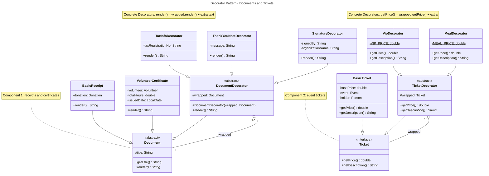
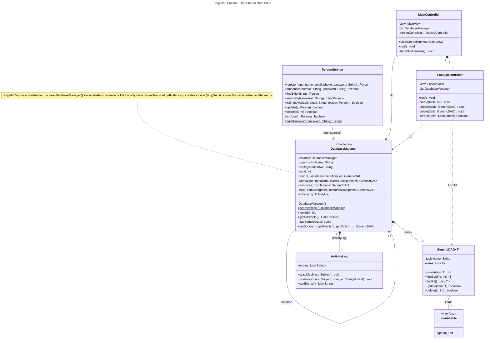

# Hope Bridge - Class Diagrams (Mermaid)

Generated from `Class Diagrams/source/*.puml` (same model as the PNG/SVG diagrams).

## Hope Bridge Non-Profit Management System - Full Class Diagram (Phase 1)

```mermaid
---
title: Hope Bridge Non-Profit Management System - Full Class Diagram (Phase 1)
---
classDiagram
  direction TB
  class Identifiable {
    <<interface>>
    +getId() int
  }
  class GenericDAO~T~ {
    -tableName: String
    -items: List~T~
    +insert(item: T) int
    +findById(id: int) T
    +findAll() List~T~
    +update(item: T) boolean
    +delete(id: int) boolean
  }
  class DatabaseManager {
    <<Singleton>>
    -instance: DatabaseManager$
    -organizationName: String
    -taxRegistrationNo: String
    -lastId: int
    -donors, volunteers, beneficiaries: GenericDAO
    -campaigns, donations, events, assignments: GenericDAO
    -resources, distributions: GenericDAO
    -skills, itemCategories, resourceCategories: GenericDAO
    -activityLog: ActivityLog
    -DatabaseManager()
    +getInstance() DatabaseManager$
    +nextId() int
    +getAllPeople() List~Person~
    -loadSampleData() void
    +getDonors() / getEvents() / getSkills() ...: GenericDAO
  }
  class LookupItem {
    <<abstract>>
    -id: int
    -name: String
    -description: String
    +getTableName() String*
    +getId() int
    +getName() / getDescription() String
    +setName(name: String) void
    +setDescription(d: String) void
  }
  class Skill {
    -requiresTraining: boolean
    +getTableName() String
  }
  class ItemCategory {
    -perishable: boolean
    +isPerishable() boolean
    +getTableName() String
  }
  class ResourceCategory {
    -essential: boolean
    +getTableName() String
  }
  class Person {
    <<abstract>>
    -id: int
    -name: String
    -email: String
    -phone: String
    -socialHandle: String
    -preferredChannel: Channel
    -passwordHash: String
    -notifications: List~Notification~
    +getRole() String*
    +receive(n: Notification) void
    +checkPassword(hash: String) boolean
    +updateContact(email, phone, social: String, c: Channel) void
    +getId() int
  }
  class Donor {
    -donorType: String
    -taxId: String
    -totalDonated: double
    +addToTotal(value: double) void
    +setDonorDetails(type: String, taxId: String) void
    +getRole() String
  }
  class Volunteer {
    -skills: List~Skill~
    -availability: List~String~
    -preferences: List~String~
    -totalHours: double
    +addSkill(s: Skill) void
    +hasSkill(s: Skill) boolean
    +prefers(eventType: String) boolean
    +addHours(hours: double) void
    +getRole() String
  }
  class Beneficiary {
    -address: String
    -familySize: int
    -needs: List~Need~
    +addNeed(id: int, c: ResourceCategory, d: String, priority: int) Need
    +hasNeed(c: ResourceCategory) boolean
    +setHousehold(address: String, familySize: int) void
    +getRole() String
  }
  class Need {
    -id: int
    -category: ResourceCategory
    -description: String
    -priority: int
    +getPriority() int
  }
  class Notification {
    -channel: Channel
    -subject: String
    -body: String
    -receivedAt: LocalDateTime
    -read: boolean
    +markAsRead() void
  }
  class PersonService {
    +register(type, name, email, phone, password: String) Person
    +authenticate(email: String, password: String) Person
    +findById(id: int) Person
    +searchByName(text: String) List~Person~
    +isEmailAvailable(email: String, except: Person) boolean
    +update(p: Person) boolean
    +delete(id: int) boolean
    +isInUse(p: Person) boolean
    +hashPassword(password: String) String$
  }
  class Channel {
    <<enumeration>>
    EMAIL
    SMS
    SOCIAL
  }
  class Message {
    -subject: String
    -body: String
    -createdAt: LocalDateTime
  }
  class NotificationStrategy {
    <<interface>>
    +send(to: Person, msg: Message) boolean
  }
  class EmailStrategy {
    +send(to: Person, msg: Message) boolean
  }
  class SmsStrategy {
    -SMS_LIMIT: int$
    +send(to: Person, msg: Message) boolean
  }
  class SocialMediaStrategy {
    +send(to: Person, msg: Message) boolean
  }
  class NotificationService {
    -strategies: Map~Channel, NotificationStrategy~
    -strategy: NotificationStrategy
    +registerStrategy(c: Channel, s: NotificationStrategy) void
    +setStrategy(s: NotificationStrategy) void
    +sendNotification(to: Person, msg: Message) boolean
    +broadcast(to: List~Person~, msg: Message) int
  }
  class Subject {
    <<interface>>
    +addObserver(o: Observer) void
    +removeObserver(o: Observer) void
    +notifyObservers(change: ChangeEvent) void
  }
  class Observer {
    <<interface>>
    +update(source: Subject, change: ChangeEvent) void
  }
  class ChangeEvent {
    -type: ChangeType
    -payload: Object
    -description: String
    -timestamp: LocalDateTime
    +getType() ChangeType
    +getPayload() Object
    +getTimestamp() LocalDateTime
  }
  class ChangeType {
    <<enumeration>>
    DONATION_RECORDED
    EVENT_RESCHEDULED
    EVENT_VENUE_CHANGED
    EVENT_CANCELLED
    EVENT_REMINDER
    EVENT_COMPLETED
    DISTRIBUTION_RECORDED
  }
  class ReceiptObserver {
    -donationService: DonationService
    +update(source: Subject, change: ChangeEvent) void
  }
  class ThankYouObserver {
    -notificationService: NotificationService
    +update(source: Subject, change: ChangeEvent) void
  }
  class StatsObserver {
    -totalRaised: double
    -donationCount: int
    +update(source: Subject, change: ChangeEvent) void
    +getTotalRaised() double
  }
  class AttendeeNotificationObserver {
    -notificationService: NotificationService
    -lastReached: int
    +update(source: Subject, change: ChangeEvent) void
    +getLastReached() int
  }
  class StockObserver {
    +update(source: Subject, change: ChangeEvent) void
  }
  class ActivityLog {
    -entries: List~String~
    +watch(subject: Subject) void
    +update(source: Subject, change: ChangeEvent) void
    +getEntries() List~String~
  }
  class DonationService {
    -observers: List~Observer~
    +addObserver(o: Observer) void
    +removeObserver(o: Observer) void
    +notifyObservers(change: ChangeEvent) void
    +recordDonation(h: DonationHandler, d: Donor, f: DonationForm) Donation
    +buildReceipt(d: Donation, options: List~String~) Document
    +getDonationsByDonor(donor: Donor) List~Donation~
    +generateTaxStatement(donor: Donor, year: int) String
  }
  class Donation {
    <<abstract>>
    -id: int
    -donor: Donor
    -campaign: Campaign
    -date: LocalDate
    -status: DonationStatus
    -confirmation: String
    -receiptOptions: List~String~
    -receipt: Document
    +getType() String*
    +validate() boolean*
    +process() String*
    +getValue() double*
    +getSummary() String*
    +setStatus(s: DonationStatus) void
    +setReceipt(r: Document) void
  }
  class MonetaryDonation {
    -amount: double
    -paymentStrategy: PaymentStrategy
    +setPaymentStrategy(p: PaymentStrategy) void
    +getType() String
    +validate() boolean
    +process() String
    +getValue() double
    +getSummary() String
  }
  class InKindDonation {
    -itemDescription: String
    -quantity: int
    -estimatedValue: double
    -category: ItemCategory
    +getType() String
    +validate() boolean
    +process() String
    +getValue() double
    +getSummary() String
  }
  class DonationStatus {
    <<enumeration>>
    PENDING
    COMPLETED
    REJECTED
  }
  class Campaign {
    -id: int
    -title: String
    -goalAmount: double
    -raisedAmount: double
    -donations: List~Donation~
    +addDonation(d: Donation) void
    +getProgress() double
  }
  class DonationForm {
    -campaign: Campaign
    -amount: double
    -paymentStrategy: PaymentStrategy
    -itemDescription: String
    -quantity: int
    -estimatedValue: double
    -itemCategory: ItemCategory
    -receiptOptions: List~String~
    +monetary(c: Campaign, amount: double, p: PaymentStrategy) DonationForm$
    +inKind(c: Campaign, item: String, qty: int, value: double, cat: ItemCategory) DonationForm$
    +withReceiptOptions(options: List~String~) DonationForm
  }
  class DonationHandler {
    <<abstract>>
    +receiveDonation(donor: Donor, form: DonationForm) Donation
    #createDonation(donor: Donor, form: DonationForm) Donation*
  }
  class MonetaryDonationHandler {
    #createDonation(donor: Donor, form: DonationForm) Donation
  }
  class InKindDonationHandler {
    #createDonation(donor: Donor, form: DonationForm) Donation
  }
  class PaymentStrategy {
    <<interface>>
    +pay(amount: double) String
    +getMethodName() String
  }
  class OnlinePayment {
    -transactionCounter: int$
    -cardHolder: String
    -cardNumber: String
    -gateway: String
    -transactionId: String
    +pay(amount: double) String
    +getMethodName() String
  }
  class CheckPayment {
    -checkNumber: String
    -bankName: String
    -clearingDate: LocalDate
    +pay(amount: double) String
    +getMethodName() String
  }
  class CashPayment {
    -receivedBy: String
    +pay(amount: double) String
    +getMethodName() String
  }
  class Document {
    <<abstract>>
    #title: String
    +getTitle() String
    +render() String*
  }
  class BasicReceipt {
    -donation: Donation
    +render() String
  }
  class VolunteerCertificate {
    -volunteer: Volunteer
    -totalHours: double
    -issuedDate: LocalDate
    +render() String
  }
  class DocumentDecorator {
    <<abstract>>
    #wrapped: Document
    +DocumentDecorator(wrapped: Document)
    +render() String*
  }
  class TaxInfoDecorator {
    -taxRegistrationNo: String
    +render() String
  }
  class ThankYouNoteDecorator {
    -message: String
    +render() String
  }
  class SignatureDecorator {
    -signedBy: String
    -organizationName: String
    +render() String
  }
  class EventService {
    -observers: List~Observer~
    +addObserver(o: Observer) void
    +removeObserver(o: Observer) void
    +notifyObservers(change: ChangeEvent) void
    +createEvent(c: EventCreator, f: EventForm) Event
    +registerAttendee(e: Event, p: Person) boolean
    +markAttendance(e: Event, p: Person) boolean
    +sellTicket(e: Event, p: Person, extras: List~String~) Ticket
    +changeDate(e: Event, newDate: LocalDate) boolean
    +changeVenue(e: Event, newVenue: String) void
    +cancelEvent(e: Event) void
    +sendReminders(e: Event) void
    +completeEvent(e: Event, hours: double) void
  }
  class Event {
    <<abstract>>
    -id: int
    -name: String
    -date: LocalDate
    -venue: String
    -capacity: int
    -ticketPrice: double
    -requiredSkill: Skill
    -status: EventStatus
    -attendees: List~Person~
    -attended: List~Person~
    -assignments: List~Assignment~
    -tickets: List~Ticket~
    +getType() String*
    +getDetails() String*
    +isOpen() boolean
    +register(p: Person) boolean
    +markAttendance(p: Person) boolean
    +updateDate(d: LocalDate) void
    +updateVenue(v: String) void
    +setStatus(s: EventStatus) void
    +getVolunteers() List~Volunteer~
  }
  class Fundraiser {
    -targetAmount: double
    +getType() String
    +getDetails() String
  }
  class Workshop {
    -trainer: String
    -topic: String
    +getType() String
    +getDetails() String
  }
  class Outreach {
    -location: String
    -teamSize: int
    +getType() String
    +getDetails() String
  }
  class EventStatus {
    <<enumeration>>
    PLANNED
    ONGOING
    COMPLETED
    CANCELLED
  }
  class EventForm {
    -name: String
    -date: LocalDate
    -venue: String
    -capacity: int
    -ticketPrice: double
    -requiredSkill: Skill
    -targetAmount: double
    -trainer, topic, location: String
    -teamSize: int
    +setFundraiserDetails(target: double) void
    +setWorkshopDetails(trainer: String, topic: String) void
    +setOutreachDetails(location: String, teamSize: int) void
  }
  class EventCreator {
    <<abstract>>
    +openEvent(form: EventForm) Event
    #createEvent(id: int, form: EventForm) Event*
  }
  class FundraiserCreator {
    #createEvent(id: int, form: EventForm) Event
  }
  class WorkshopCreator {
    #createEvent(id: int, form: EventForm) Event
  }
  class OutreachCreator {
    #createEvent(id: int, form: EventForm) Event
  }
  class Ticket {
    <<interface>>
    +getPrice() double
    +getDescription() String
  }
  class BasicTicket {
    -basePrice: double
    -event: Event
    -holder: Person
    +getPrice() double
    +getDescription() String
  }
  class TicketDecorator {
    <<abstract>>
    #wrapped: Ticket
    +getPrice() double*
    +getDescription() String*
  }
  class VipDecorator {
    -VIP_PRICE: double$
    +getPrice() double
    +getDescription() String
  }
  class MealDecorator {
    -MEAL_PRICE: double$
    +getPrice() double
    +getDescription() String
  }
  class VolunteerService {
    +assign(v: Volunteer, e: Event, role: String) Assignment
    +logHours(a: Assignment, hours: double) void
    +findBySkill(s: Skill) List~Volunteer~
    +suggestVolunteers(e: Event) List~Volunteer~
    +getAssignmentsByEvent(e: Event) List~Assignment~
    +getAssignmentsByVolunteer(v: Volunteer) List~Assignment~
    +generateCertificate(v: Volunteer) Document
  }
  class Assignment {
    -id: int
    -volunteer: Volunteer
    -event: Event
    -role: String
    -hoursWorked: double
    -date: LocalDate
    +logHours(hours: double) void
  }
  class DistributionService {
    -observers: List~Observer~
    -evaluator: ImpactEvaluator
    +addObserver(o: Observer) void
    +removeObserver(o: Observer) void
    +notifyObservers(change: ChangeEvent) void
    +recordDistribution(b: Beneficiary, r: Resource, qty: int) Distribution
    +getDistributionsByBeneficiary(b: Beneficiary) List~Distribution~
    +evaluateImpact(programType: ResourceCategory, s: ImpactEvaluationStrategy) ImpactReport
  }
  class Distribution {
    -id: int
    -date: LocalDate
    -beneficiary: Beneficiary
    -resource: Resource
    -quantity: int
  }
  class Resource {
    -id: int
    -name: String
    -unit: String
    -stockQuantity: int
    -category: ResourceCategory
    +hasStock(qty: int) boolean
    +reduceStock(qty: int) void
    +addStock(qty: int) void
  }
  class ImpactEvaluator {
    -strategy: ImpactEvaluationStrategy
    +setStrategy(s: ImpactEvaluationStrategy) void
    +evaluate(d: List~Distribution~) ImpactReport
  }
  class ImpactEvaluationStrategy {
    <<interface>>
    +evaluate(d: List~Distribution~) ImpactReport
  }
  class FoodAidImpactStrategy {
    +evaluate(d: List~Distribution~) ImpactReport
  }
  class EducationImpactStrategy {
    +evaluate(d: List~Distribution~) ImpactReport
  }
  class ImpactReport {
    -programName: String
    -score: double
    -summary: String
  }
  class View {
    <<abstract>>
    #SCANNER: Scanner$
    +show() int*
    +showTitle(title: String) void
    +showMessage(msg: String) void
    +showError(msg: String) void
    +readText / readInt / readDouble / readYesNo / readDate(prompt: String)
    +showLookupItems(items: List~LookupItem~) void
    +showPeople(people: List~Person~) void
    +showDocument(d: Document) void
  }
  class MainView {
    +show() int
    +showNotifications(p: Person) void
    +showActivityLog(entries: List~String~) void
  }
  class PersonView {
    +show() int
    +showSignupForm() void
    +showLoginForm() void
    +askRole() int
    +askChannel() Channel
    +showProfile(p: Person) void
  }
  class DonationView {
    +show() int
    +askDonationType() int
    +askPaymentMethod() int
    +showDonationList(list: List~Donation~) void
    +showReceipt(receipt: Document) void
    +showCampaigns(list: List~Campaign~) void
    +showStats(total: double, count: int) void
  }
  class EventView {
    +show() int
    +askEventType() int
    +showEventList(list: List~Event~) void
    +showTicket(t: Ticket) void
  }
  class VolunteerView {
    +show() int
    +showVolunteers(list: List~Volunteer~) void
    +showAssignments(list: List~Assignment~) void
    +showCertificate(c: Document) void
  }
  class BeneficiaryView {
    +show() int
    +askProgram() int
    +showBeneficiaries(list: List~Beneficiary~) void
    +showResources(list: List~Resource~) void
    +showDistributions(list: List~Distribution~) void
    +showImpact(r: ImpactReport) void
  }
  class LookupView {
    +show() int
    +showTableMenu(tableName: String) int
  }
  class MainController {
    -view: MainView
    -db: DatabaseManager
    -personController ... lookupController
    +MainController(view: MainView)
    +run() void
    -showNotifications() void
  }
  class PersonController {
    -view: PersonView
    -personService: PersonService
    +run() void
    -signup() / login() / search() void
    -updateContact() / deletePerson() void
  }
  class DonationController {
    -view: DonationView
    -donationService: DonationService
    -statsObserver: StatsObserver
    -db: DatabaseManager
    +run() void
    -loadDonations() / submitDonation() void
    -choosePaymentStrategy(d: Donor) PaymentStrategy
    -taxStatement() / generateReceipt() void
  }
  class EventController {
    -view: EventView
    -eventService: EventService
    -personService: PersonService
    -attendeeObserver: AttendeeNotificationObserver
    -db: DatabaseManager
    +run() void
    -loadEvents() / createEvent() / registerAttendee() void
    -sellTicket() / markAttendance() / changeDate() void
    -changeVenue() / cancelEvent() / sendReminders() void
    -completeEvent() void
  }
  class VolunteerController {
    -view: VolunteerView
    -volunteerService: VolunteerService
    -db: DatabaseManager
    +run() void
    -loadVolunteers() / suggest() / assign() void
    -logHours() / showAssignments() / issueCertificate() void
  }
  class BeneficiaryController {
    -view: BeneficiaryView
    -distributionService: DistributionService
    -db: DatabaseManager
    +run() void
    -loadBeneficiaries() / addNeed() / recordDistribution() void
    -showDistributions() / restock() / showImpact() void
  }
  class LookupController {
    -view: LookupView
    -db: DatabaseManager
    +run() void
    -create(table: int) void
    -update(table: GenericDAO) void
    -delete(table: GenericDAO) void
    -isInUse(item: LookupItem) boolean
  }
  class Main {
    +main(args: String[]) void$
  }

  DatabaseManager --> "0..1" DatabaseManager : instance
  DatabaseManager "1" *-- "12" GenericDAO : tables
  DatabaseManager "1" *-- "1" ActivityLog : activityLog
  GenericDAO "1" o-- "0..*" Identifiable : items
  Person ..|> Identifiable
  LookupItem ..|> Identifiable
  Donation ..|> Identifiable
  Campaign ..|> Identifiable
  Event ..|> Identifiable
  Assignment ..|> Identifiable
  Resource ..|> Identifiable
  Distribution ..|> Identifiable
  Skill --|> LookupItem
  ItemCategory --|> LookupItem
  ResourceCategory --|> LookupItem
  Donor --|> Person
  Volunteer --|> Person
  Beneficiary --|> Person
  Person "1" *-- "0..*" Notification : notifications
  Person "0..*" --> "1" Channel : preferredChannel
  Notification "0..*" --> "1" Channel : channel
  Volunteer "0..*" o-- "0..*" Skill : skills
  Beneficiary "1" *-- "0..*" Need : needs
  Need "0..*" --> "1" ResourceCategory : category
  PersonService ..> Person : manages
  PersonService ..> DatabaseManager : getInstance()
  EmailStrategy ..|> NotificationStrategy
  SmsStrategy ..|> NotificationStrategy
  SocialMediaStrategy ..|> NotificationStrategy
  NotificationService "1" o-- "0..*" NotificationStrategy : strategies
  NotificationService ..> Message
  NotificationService ..> Channel : keys strategies
  NotificationStrategy ..> Notification : delivers
  Subject "1" --> "0..*" Observer : observers
  DonationService ..|> Subject
  EventService ..|> Subject
  DistributionService ..|> Subject
  ReceiptObserver ..|> Observer
  ThankYouObserver ..|> Observer
  StatsObserver ..|> Observer
  AttendeeNotificationObserver ..|> Observer
  StockObserver ..|> Observer
  ActivityLog ..|> Observer
  Observer ..> ChangeEvent
  ChangeEvent "0..*" --> "1" ChangeType : type
  ReceiptObserver "0..*" --> "1" DonationService : donationService
  ThankYouObserver "0..*" --> "1" NotificationService : notificationService
  AttendeeNotificationObserver "0..*" --> "1" NotificationService : notificationService
  StatsObserver ..> Campaign : updates progress
  StockObserver ..> Resource : reduces stock
  ActivityLog ..> Subject : watch()
  MonetaryDonation --|> Donation
  InKindDonation --|> Donation
  Donation "0..*" --> "1" Donor : donor
  Donation "0..*" --> "1" Campaign : campaign
  Donation "0..*" --> "1" DonationStatus : status
  Donation "1" --> "0..1" Document : receipt
  Campaign "1" o-- "0..*" Donation : donations
  MonetaryDonation "0..*" o-- "1" PaymentStrategy : paymentStrategy
  InKindDonation "0..*" --> "1" ItemCategory : category
  OnlinePayment ..|> PaymentStrategy
  CheckPayment ..|> PaymentStrategy
  CashPayment ..|> PaymentStrategy
  DonationForm "0..*" --> "1" Campaign : campaign
  DonationForm "0..*" --> "0..1" PaymentStrategy : paymentStrategy
  DonationForm "0..*" --> "0..1" ItemCategory : itemCategory
  MonetaryDonationHandler --|> DonationHandler
  InKindDonationHandler --|> DonationHandler
  DonationHandler ..> Donation : uses product
  DonationHandler ..> DonationForm
  MonetaryDonationHandler ..> MonetaryDonation : «create»
  InKindDonationHandler ..> InKindDonation : «create»
  DonationService ..> DonationHandler : recordDonation()
  DonationService ..> Document : buildReceipt()
  BasicReceipt --|> Document
  VolunteerCertificate --|> Document
  DocumentDecorator --|> Document
  DocumentDecorator "0..*" o-- "1" Document : wrapped
  TaxInfoDecorator --|> DocumentDecorator
  ThankYouNoteDecorator --|> DocumentDecorator
  SignatureDecorator --|> DocumentDecorator
  BasicReceipt "0..*" --> "1" Donation : donation
  VolunteerCertificate "0..*" --> "1" Volunteer : volunteer
  Fundraiser --|> Event
  Workshop --|> Event
  Outreach --|> Event
  Event "0..*" --> "1" EventStatus : status
  Event "0..*" --> "0..1" Skill : requiredSkill
  Event "0..*" o-- "0..*" Person : attendees / attended
  Event "1" o-- "0..*" Assignment : assignments
  Event "1" o-- "0..*" Ticket : tickets
  EventForm "0..*" --> "0..1" Skill : requiredSkill
  FundraiserCreator --|> EventCreator
  WorkshopCreator --|> EventCreator
  OutreachCreator --|> EventCreator
  EventCreator ..> Event : uses product
  EventCreator ..> EventForm
  FundraiserCreator ..> Fundraiser : «create»
  WorkshopCreator ..> Workshop : «create»
  OutreachCreator ..> Outreach : «create»
  EventService ..> EventCreator : createEvent()
  EventService ..> TicketDecorator : sellTicket()
  BasicTicket ..|> Ticket
  TicketDecorator ..|> Ticket
  TicketDecorator "0..*" o-- "1" Ticket : wrapped
  VipDecorator --|> TicketDecorator
  MealDecorator --|> TicketDecorator
  BasicTicket "0..*" --> "1" Event : event
  BasicTicket "0..*" --> "1" Person : holder
  Assignment "0..*" --> "1" Volunteer : volunteer
  Assignment "0..*" --> "1" Event : event
  VolunteerService ..> Assignment : «create»
  VolunteerService ..> VolunteerCertificate : generateCertificate()
  Resource "0..*" --> "1" ResourceCategory : category
  Distribution "0..*" --> "1" Beneficiary : beneficiary
  Distribution "0..*" --> "1" Resource : resource
  FoodAidImpactStrategy ..|> ImpactEvaluationStrategy
  EducationImpactStrategy ..|> ImpactEvaluationStrategy
  ImpactEvaluator "1" o-- "0..1" ImpactEvaluationStrategy : strategy
  ImpactEvaluationStrategy ..> ImpactReport : creates
  ImpactEvaluationStrategy ..> Distribution : scores
  DistributionService "1" *-- "1" ImpactEvaluator : evaluator
  DistributionService ..> Distribution : «create»
  MainView --|> View
  PersonView --|> View
  DonationView --|> View
  EventView --|> View
  VolunteerView --|> View
  BeneficiaryView --|> View
  LookupView --|> View
  View ..> Document : showDocument()
  Main ..> MainController : «create»
  MainController "1" --> "1" MainView : view
  MainController "1" *-- "1" PersonController
  MainController "1" *-- "1" DonationController
  MainController "1" *-- "1" EventController
  MainController "1" *-- "1" VolunteerController
  MainController "1" *-- "1" BeneficiaryController
  MainController "1" *-- "1" LookupController
  MainController ..> NotificationService : «create» + registerStrategy()
  MainController ..> Observer : «create» subscribers
  PersonController "1" --> "1" PersonView : view
  DonationController "1" --> "1" DonationView : view
  EventController "1" --> "1" EventView : view
  VolunteerController "1" --> "1" VolunteerView : view
  BeneficiaryController "1" --> "1" BeneficiaryView : view
  LookupController "1" --> "1" LookupView : view
  PersonController "0..*" --> "1" PersonService : personService
  DonationController "0..*" --> "1" DonationService : donationService
  DonationController "0..*" --> "1" StatsObserver : statsObserver
  EventController "0..*" --> "1" EventService : eventService
  EventController "0..*" --> "1" AttendeeNotificationObserver : attendeeObserver
  VolunteerController "0..*" --> "1" VolunteerService : volunteerService
  BeneficiaryController "0..*" --> "1" DistributionService : distributionService
  MainController --> "1" DatabaseManager : db
  LookupController --> "1" DatabaseManager : db
  DonationController --> "1" DatabaseManager : db
  EventController --> "1" DatabaseManager : db
  VolunteerController --> "1" DatabaseManager : db
  BeneficiaryController --> "1" DatabaseManager : db
  EventController "0..*" --> "1" PersonService : personService
  DonationController ..> PaymentStrategy : chooses strategy
  DonationController ..> DonationHandler : chooses creator
  EventController ..> EventCreator : chooses creator
  BeneficiaryController ..> ImpactEvaluationStrategy : chooses strategy
  LookupController ..> GenericDAO : CRUD
  LookupController ..> LookupItem : edits rows
```

## Strategy Pattern - Payment, Notification Channel and Impact Evaluation

```mermaid
---
title: Strategy Pattern - Payment, Notification Channel and Impact Evaluation
---
classDiagram
  direction TB
  class Channel {
    <<enumeration>>
    EMAIL
    SMS
    SOCIAL
  }
  class Message {
    -subject: String
    -body: String
    -createdAt: LocalDateTime
  }
  class NotificationStrategy {
    <<interface>>
    +send(to: Person, msg: Message) boolean
  }
  class EmailStrategy {
    +send(to: Person, msg: Message) boolean
  }
  class SmsStrategy {
    -SMS_LIMIT: int$
    +send(to: Person, msg: Message) boolean
  }
  class SocialMediaStrategy {
    +send(to: Person, msg: Message) boolean
  }
  class NotificationService {
    -strategies: Map~Channel, NotificationStrategy~
    -strategy: NotificationStrategy
    +registerStrategy(c: Channel, s: NotificationStrategy) void
    +setStrategy(s: NotificationStrategy) void
    +sendNotification(to: Person, msg: Message) boolean
    +broadcast(to: List~Person~, msg: Message) int
  }
  class MonetaryDonation {
    -amount: double
    -paymentStrategy: PaymentStrategy
    +setPaymentStrategy(p: PaymentStrategy) void
    +getType() String
    +validate() boolean
    +process() String
    +getValue() double
    +getSummary() String
  }
  class PaymentStrategy {
    <<interface>>
    +pay(amount: double) String
    +getMethodName() String
  }
  class OnlinePayment {
    -transactionCounter: int$
    -cardHolder: String
    -cardNumber: String
    -gateway: String
    -transactionId: String
    +pay(amount: double) String
    +getMethodName() String
  }
  class CheckPayment {
    -checkNumber: String
    -bankName: String
    -clearingDate: LocalDate
    +pay(amount: double) String
    +getMethodName() String
  }
  class CashPayment {
    -receivedBy: String
    +pay(amount: double) String
    +getMethodName() String
  }
  class ImpactEvaluator {
    -strategy: ImpactEvaluationStrategy
    +setStrategy(s: ImpactEvaluationStrategy) void
    +evaluate(d: List~Distribution~) ImpactReport
  }
  class ImpactEvaluationStrategy {
    <<interface>>
    +evaluate(d: List~Distribution~) ImpactReport
  }
  class FoodAidImpactStrategy {
    +evaluate(d: List~Distribution~) ImpactReport
  }
  class EducationImpactStrategy {
    +evaluate(d: List~Distribution~) ImpactReport
  }
  class ImpactReport {
    -programName: String
    -score: double
    -summary: String
  }
  class DonationController {
    -view: DonationView
    -donationService: DonationService
    -statsObserver: StatsObserver
    -db: DatabaseManager
    +run() void
    -loadDonations() / submitDonation() void
    -choosePaymentStrategy(d: Donor) PaymentStrategy
    -taxStatement() / generateReceipt() void
  }
  class BeneficiaryController {
    -view: BeneficiaryView
    -distributionService: DistributionService
    -db: DatabaseManager
    +run() void
    -loadBeneficiaries() / addNeed() / recordDistribution() void
    -showDistributions() / restock() / showImpact() void
  }

  EmailStrategy ..|> NotificationStrategy
  SmsStrategy ..|> NotificationStrategy
  SocialMediaStrategy ..|> NotificationStrategy
  NotificationService "1" o-- "0..*" NotificationStrategy : strategies
  NotificationService ..> Message
  NotificationService ..> Channel : keys strategies
  MonetaryDonation "0..*" o-- "1" PaymentStrategy : paymentStrategy
  OnlinePayment ..|> PaymentStrategy
  CheckPayment ..|> PaymentStrategy
  CashPayment ..|> PaymentStrategy
  FoodAidImpactStrategy ..|> ImpactEvaluationStrategy
  EducationImpactStrategy ..|> ImpactEvaluationStrategy
  ImpactEvaluator "1" o-- "0..1" ImpactEvaluationStrategy : strategy
  ImpactEvaluationStrategy ..> ImpactReport : creates
  DonationController ..> PaymentStrategy : chooses strategy
  BeneficiaryController ..> ImpactEvaluationStrategy : chooses strategy

  note for PaymentStrategy "Strategy 1 - payment\nContext: MonetaryDonation\n(setPaymentStrategy at runtime)"
  note for NotificationStrategy "Strategy 2 - communication channel\nContext: NotificationService picks the\nstrategy from each recipient's preferred channel"
  note for ImpactEvaluationStrategy "Strategy 3 - impact evaluation\nContext: ImpactEvaluator (setStrategy)"
```



## Observer Pattern - Donations, Events and Distributions

```mermaid
---
title: Observer Pattern - Donations, Events and Distributions
---
classDiagram
  direction TB
  class NotificationService {
    -strategies: Map~Channel, NotificationStrategy~
    -strategy: NotificationStrategy
    +registerStrategy(c: Channel, s: NotificationStrategy) void
    +setStrategy(s: NotificationStrategy) void
    +sendNotification(to: Person, msg: Message) boolean
    +broadcast(to: List~Person~, msg: Message) int
  }
  class Subject {
    <<interface>>
    +addObserver(o: Observer) void
    +removeObserver(o: Observer) void
    +notifyObservers(change: ChangeEvent) void
  }
  class Observer {
    <<interface>>
    +update(source: Subject, change: ChangeEvent) void
  }
  class ChangeEvent {
    -type: ChangeType
    -payload: Object
    -description: String
    -timestamp: LocalDateTime
    +getType() ChangeType
    +getPayload() Object
    +getTimestamp() LocalDateTime
  }
  class ChangeType {
    <<enumeration>>
    DONATION_RECORDED
    EVENT_RESCHEDULED
    EVENT_VENUE_CHANGED
    EVENT_CANCELLED
    EVENT_REMINDER
    EVENT_COMPLETED
    DISTRIBUTION_RECORDED
  }
  class ReceiptObserver {
    -donationService: DonationService
    +update(source: Subject, change: ChangeEvent) void
  }
  class ThankYouObserver {
    -notificationService: NotificationService
    +update(source: Subject, change: ChangeEvent) void
  }
  class StatsObserver {
    -totalRaised: double
    -donationCount: int
    +update(source: Subject, change: ChangeEvent) void
    +getTotalRaised() double
  }
  class AttendeeNotificationObserver {
    -notificationService: NotificationService
    -lastReached: int
    +update(source: Subject, change: ChangeEvent) void
    +getLastReached() int
  }
  class StockObserver {
    +update(source: Subject, change: ChangeEvent) void
  }
  class ActivityLog {
    -entries: List~String~
    +watch(subject: Subject) void
    +update(source: Subject, change: ChangeEvent) void
    +getEntries() List~String~
  }
  class DonationService {
    -observers: List~Observer~
    +addObserver(o: Observer) void
    +removeObserver(o: Observer) void
    +notifyObservers(change: ChangeEvent) void
    +recordDonation(h: DonationHandler, d: Donor, f: DonationForm) Donation
    +buildReceipt(d: Donation, options: List~String~) Document
    +getDonationsByDonor(donor: Donor) List~Donation~
    +generateTaxStatement(donor: Donor, year: int) String
  }
  class EventService {
    -observers: List~Observer~
    +addObserver(o: Observer) void
    +removeObserver(o: Observer) void
    +notifyObservers(change: ChangeEvent) void
    +createEvent(c: EventCreator, f: EventForm) Event
    +registerAttendee(e: Event, p: Person) boolean
    +markAttendance(e: Event, p: Person) boolean
    +sellTicket(e: Event, p: Person, extras: List~String~) Ticket
    +changeDate(e: Event, newDate: LocalDate) boolean
    +changeVenue(e: Event, newVenue: String) void
    +cancelEvent(e: Event) void
    +sendReminders(e: Event) void
    +completeEvent(e: Event, hours: double) void
  }
  class DistributionService {
    -observers: List~Observer~
    -evaluator: ImpactEvaluator
    +addObserver(o: Observer) void
    +removeObserver(o: Observer) void
    +notifyObservers(change: ChangeEvent) void
    +recordDistribution(b: Beneficiary, r: Resource, qty: int) Distribution
    +getDistributionsByBeneficiary(b: Beneficiary) List~Distribution~
    +evaluateImpact(programType: ResourceCategory, s: ImpactEvaluationStrategy) ImpactReport
  }

  Subject "1" --> "0..*" Observer : observers
  DonationService ..|> Subject
  EventService ..|> Subject
  DistributionService ..|> Subject
  ReceiptObserver ..|> Observer
  ThankYouObserver ..|> Observer
  StatsObserver ..|> Observer
  AttendeeNotificationObserver ..|> Observer
  StockObserver ..|> Observer
  ActivityLog ..|> Observer
  Observer ..> ChangeEvent
  ChangeEvent "0..*" --> "1" ChangeType : type
  ReceiptObserver "0..*" --> "1" DonationService : donationService
  ThankYouObserver "0..*" --> "1" NotificationService : notificationService
  AttendeeNotificationObserver "0..*" --> "1" NotificationService : notificationService
  ActivityLog ..> Subject : watch()

  note for Subject "Subject (publisher)"
  note for Observer "Observer (subscriber)\nupdate(source, change)"
  note for DonationService "Concrete Subjects\nevery change -> notifyObservers(new ChangeEvent(...))"
  note for ActivityLog "Concrete Observers subscribe themselves\n(constructor or watch() calls subject.addObserver(this))"
```



## Decorator Pattern - Documents and Tickets



## Factory Method Pattern - Creating Donations and Events

```mermaid
---
title: Factory Method Pattern - Creating Donations and Events
---
classDiagram
  direction TB
  class Donation {
    <<abstract>>
    -id: int
    -donor: Donor
    -campaign: Campaign
    -date: LocalDate
    -status: DonationStatus
    -confirmation: String
    -receiptOptions: List~String~
    -receipt: Document
    +getType() String*
    +validate() boolean*
    +process() String*
    +getValue() double*
    +getSummary() String*
    +setStatus(s: DonationStatus) void
    +setReceipt(r: Document) void
  }
  class MonetaryDonation {
    -amount: double
    -paymentStrategy: PaymentStrategy
    +setPaymentStrategy(p: PaymentStrategy) void
    +getType() String
    +validate() boolean
    +process() String
    +getValue() double
    +getSummary() String
  }
  class InKindDonation {
    -itemDescription: String
    -quantity: int
    -estimatedValue: double
    -category: ItemCategory
    +getType() String
    +validate() boolean
    +process() String
    +getValue() double
    +getSummary() String
  }
  class DonationForm {
    -campaign: Campaign
    -amount: double
    -paymentStrategy: PaymentStrategy
    -itemDescription: String
    -quantity: int
    -estimatedValue: double
    -itemCategory: ItemCategory
    -receiptOptions: List~String~
    +monetary(c: Campaign, amount: double, p: PaymentStrategy) DonationForm$
    +inKind(c: Campaign, item: String, qty: int, value: double, cat: ItemCategory) DonationForm$
    +withReceiptOptions(options: List~String~) DonationForm
  }
  class DonationHandler {
    <<abstract>>
    +receiveDonation(donor: Donor, form: DonationForm) Donation
    #createDonation(donor: Donor, form: DonationForm) Donation*
  }
  class MonetaryDonationHandler {
    #createDonation(donor: Donor, form: DonationForm) Donation
  }
  class InKindDonationHandler {
    #createDonation(donor: Donor, form: DonationForm) Donation
  }
  class Event {
    <<abstract>>
    -id: int
    -name: String
    -date: LocalDate
    -venue: String
    -capacity: int
    -ticketPrice: double
    -requiredSkill: Skill
    -status: EventStatus
    -attendees: List~Person~
    -attended: List~Person~
    -assignments: List~Assignment~
    -tickets: List~Ticket~
    +getType() String*
    +getDetails() String*
    +isOpen() boolean
    +register(p: Person) boolean
    +markAttendance(p: Person) boolean
    +updateDate(d: LocalDate) void
    +updateVenue(v: String) void
    +setStatus(s: EventStatus) void
    +getVolunteers() List~Volunteer~
  }
  class Fundraiser {
    -targetAmount: double
    +getType() String
    +getDetails() String
  }
  class Workshop {
    -trainer: String
    -topic: String
    +getType() String
    +getDetails() String
  }
  class Outreach {
    -location: String
    -teamSize: int
    +getType() String
    +getDetails() String
  }
  class EventForm {
    -name: String
    -date: LocalDate
    -venue: String
    -capacity: int
    -ticketPrice: double
    -requiredSkill: Skill
    -targetAmount: double
    -trainer, topic, location: String
    -teamSize: int
    +setFundraiserDetails(target: double) void
    +setWorkshopDetails(trainer: String, topic: String) void
    +setOutreachDetails(location: String, teamSize: int) void
  }
  class EventCreator {
    <<abstract>>
    +openEvent(form: EventForm) Event
    #createEvent(id: int, form: EventForm) Event*
  }
  class FundraiserCreator {
    #createEvent(id: int, form: EventForm) Event
  }
  class WorkshopCreator {
    #createEvent(id: int, form: EventForm) Event
  }
  class OutreachCreator {
    #createEvent(id: int, form: EventForm) Event
  }

  MonetaryDonation --|> Donation
  InKindDonation --|> Donation
  MonetaryDonationHandler --|> DonationHandler
  InKindDonationHandler --|> DonationHandler
  DonationHandler ..> Donation : uses product
  DonationHandler ..> DonationForm
  MonetaryDonationHandler ..> MonetaryDonation : «create»
  InKindDonationHandler ..> InKindDonation : «create»
  Fundraiser --|> Event
  Workshop --|> Event
  Outreach --|> Event
  FundraiserCreator --|> EventCreator
  WorkshopCreator --|> EventCreator
  OutreachCreator --|> EventCreator
  EventCreator ..> Event : uses product
  EventCreator ..> EventForm
  FundraiserCreator ..> Fundraiser : «create»
  WorkshopCreator ..> Workshop : «create»
  OutreachCreator ..> Outreach : «create»

  note for DonationHandler "Creator: receiveDonation() = common workflow\ncreateDonation() = factory method"
  note for EventCreator "Creator: openEvent() = common workflow\ncreateEvent() = factory method"
  note for Donation "Product"
  note for Event "Product"
```



## Singleton Pattern - One Shared Data Store



## MVC Architecture and CRUD Lookup Tables

```mermaid
---
title: MVC Architecture and CRUD Lookup Tables
---
classDiagram
  direction TB
  class GenericDAO~T~ {
    -tableName: String
    -items: List~T~
    +insert(item: T) int
    +findById(id: int) T
    +findAll() List~T~
    +update(item: T) boolean
    +delete(id: int) boolean
  }
  class DatabaseManager {
    <<Singleton>>
    -instance: DatabaseManager$
    -organizationName: String
    -taxRegistrationNo: String
    -lastId: int
    -donors, volunteers, beneficiaries: GenericDAO
    -campaigns, donations, events, assignments: GenericDAO
    -resources, distributions: GenericDAO
    -skills, itemCategories, resourceCategories: GenericDAO
    -activityLog: ActivityLog
    -DatabaseManager()
    +getInstance() DatabaseManager$
    +nextId() int
    +getAllPeople() List~Person~
    -loadSampleData() void
    +getDonors() / getEvents() / getSkills() ...: GenericDAO
  }
  class LookupItem {
    <<abstract>>
    -id: int
    -name: String
    -description: String
    +getTableName() String*
    +getId() int
    +getName() / getDescription() String
    +setName(name: String) void
    +setDescription(d: String) void
  }
  class Skill {
    -requiresTraining: boolean
    +getTableName() String
  }
  class ItemCategory {
    -perishable: boolean
    +isPerishable() boolean
    +getTableName() String
  }
  class ResourceCategory {
    -essential: boolean
    +getTableName() String
  }
  class View {
    <<abstract>>
    #SCANNER: Scanner$
    +show() int*
    +showTitle(title: String) void
    +showMessage(msg: String) void
    +showError(msg: String) void
    +readText / readInt / readDouble / readYesNo / readDate(prompt: String)
    +showLookupItems(items: List~LookupItem~) void
    +showPeople(people: List~Person~) void
    +showDocument(d: Document) void
  }
  class MainView {
    +show() int
    +showNotifications(p: Person) void
    +showActivityLog(entries: List~String~) void
  }
  class PersonView {
    +show() int
    +showSignupForm() void
    +showLoginForm() void
    +askRole() int
    +askChannel() Channel
    +showProfile(p: Person) void
  }
  class DonationView {
    +show() int
    +askDonationType() int
    +askPaymentMethod() int
    +showDonationList(list: List~Donation~) void
    +showReceipt(receipt: Document) void
    +showCampaigns(list: List~Campaign~) void
    +showStats(total: double, count: int) void
  }
  class EventView {
    +show() int
    +askEventType() int
    +showEventList(list: List~Event~) void
    +showTicket(t: Ticket) void
  }
  class VolunteerView {
    +show() int
    +showVolunteers(list: List~Volunteer~) void
    +showAssignments(list: List~Assignment~) void
    +showCertificate(c: Document) void
  }
  class BeneficiaryView {
    +show() int
    +askProgram() int
    +showBeneficiaries(list: List~Beneficiary~) void
    +showResources(list: List~Resource~) void
    +showDistributions(list: List~Distribution~) void
    +showImpact(r: ImpactReport) void
  }
  class LookupView {
    +show() int
    +showTableMenu(tableName: String) int
  }
  class MainController {
    -view: MainView
    -db: DatabaseManager
    -personController ... lookupController
    +MainController(view: MainView)
    +run() void
    -showNotifications() void
  }
  class PersonController {
    -view: PersonView
    -personService: PersonService
    +run() void
    -signup() / login() / search() void
    -updateContact() / deletePerson() void
  }
  class DonationController {
    -view: DonationView
    -donationService: DonationService
    -statsObserver: StatsObserver
    -db: DatabaseManager
    +run() void
    -loadDonations() / submitDonation() void
    -choosePaymentStrategy(d: Donor) PaymentStrategy
    -taxStatement() / generateReceipt() void
  }
  class EventController {
    -view: EventView
    -eventService: EventService
    -personService: PersonService
    -attendeeObserver: AttendeeNotificationObserver
    -db: DatabaseManager
    +run() void
    -loadEvents() / createEvent() / registerAttendee() void
    -sellTicket() / markAttendance() / changeDate() void
    -changeVenue() / cancelEvent() / sendReminders() void
    -completeEvent() void
  }
  class VolunteerController {
    -view: VolunteerView
    -volunteerService: VolunteerService
    -db: DatabaseManager
    +run() void
    -loadVolunteers() / suggest() / assign() void
    -logHours() / showAssignments() / issueCertificate() void
  }
  class BeneficiaryController {
    -view: BeneficiaryView
    -distributionService: DistributionService
    -db: DatabaseManager
    +run() void
    -loadBeneficiaries() / addNeed() / recordDistribution() void
    -showDistributions() / restock() / showImpact() void
  }
  class LookupController {
    -view: LookupView
    -db: DatabaseManager
    +run() void
    -create(table: int) void
    -update(table: GenericDAO) void
    -delete(table: GenericDAO) void
    -isInUse(item: LookupItem) boolean
  }
  class Main {
    +main(args: String[]) void$
  }

  DatabaseManager --> "0..1" DatabaseManager : instance
  DatabaseManager "1" *-- "12" GenericDAO : tables
  Skill --|> LookupItem
  ItemCategory --|> LookupItem
  ResourceCategory --|> LookupItem
  MainView --|> View
  PersonView --|> View
  DonationView --|> View
  EventView --|> View
  VolunteerView --|> View
  BeneficiaryView --|> View
  LookupView --|> View
  Main ..> MainController : «create»
  MainController "1" --> "1" MainView : view
  MainController "1" *-- "1" PersonController
  MainController "1" *-- "1" DonationController
  MainController "1" *-- "1" EventController
  MainController "1" *-- "1" VolunteerController
  MainController "1" *-- "1" BeneficiaryController
  MainController "1" *-- "1" LookupController
  PersonController "1" --> "1" PersonView : view
  DonationController "1" --> "1" DonationView : view
  EventController "1" --> "1" EventView : view
  VolunteerController "1" --> "1" VolunteerView : view
  BeneficiaryController "1" --> "1" BeneficiaryView : view
  LookupController "1" --> "1" LookupView : view
  MainController --> "1" DatabaseManager : db
  LookupController --> "1" DatabaseManager : db
  DonationController --> "1" DatabaseManager : db
  EventController --> "1" DatabaseManager : db
  VolunteerController --> "1" DatabaseManager : db
  BeneficiaryController --> "1" DatabaseManager : db
  LookupController ..> GenericDAO : CRUD
  LookupController ..> LookupItem : edits rows

  note for View "View: the only layer that reads input and prints output"
  note for LookupItem "CRUD lookup tables: GenericDAO insert / findAll / findById / update / delete\nrows still in use cannot be deleted (LookupController.isInUse)"
```


